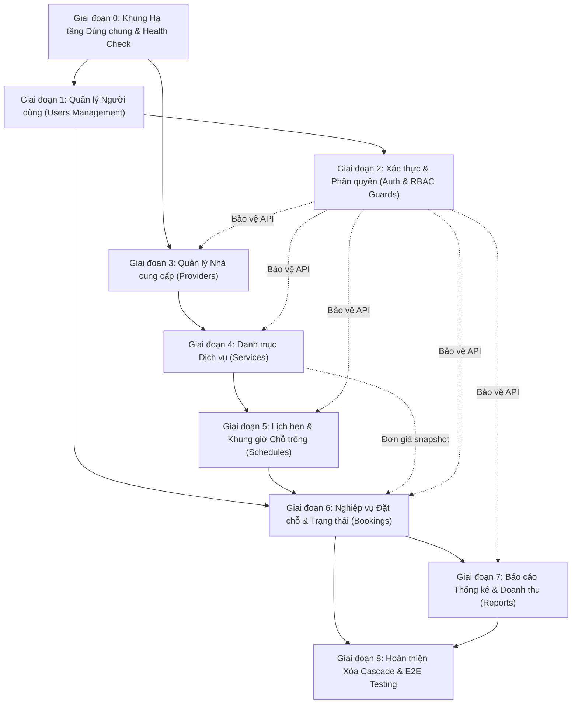

# KẾ HOẠCH PHÁT TRIỂN TỔNG QUAN BACKEND (BACKEND DEVELOPMENT PLAN)
## DỰ ÁN: BOOKING APP (DEMO VERSION)
### Phiên bản: 1.0.0 | Tiêu chuẩn: Clean Architecture & NestJS 12

---

## 1. TỔNG QUAN & NGUYÊN TẮC PHÂN CHIA GIAI ĐOẠN

### 1.1. Mục tiêu tài liệu
Tài liệu này xác lập lộ trình phát triển toàn diện cho phần Backend của hệ thống **Booking App**, phân rã thành các giai đoạn phát triển tuần tự, khép kín và có thể **kiểm thử độc lập (Independently Testable)**. Kế hoạch tập trung vào:
- **Thiết kế cấu trúc kiến trúc (Clean Architecture)**: Phân tách rõ ràng giữa Domain, Application, Infrastructure và Presentation.
- **Luồng hoạt động nghiệp vụ (Business Flow)**: Bám sát [Đặc tả yêu cầu nghiệp vụ](docs/requiments_specification/Requirements_Specification.md) (BR-01 đến BR-05, UC-01 đến UC-12).
- **Hợp đồng giao tiếp (API Contract)**: Chuẩn hóa theo [Tài liệu Đặc tả API Contract](docs/api/api_contract.md).
- **Mô hình dữ liệu quan hệ**: Đồng bộ với [Đặc tả CSDL DBML](docs/database/schema.dbml) trên nền tảng PostgreSQL 16.

### 1.2. Nguyên tắc ưu tiên phụ thuộc (Dependency-Driven Prioritization)
Nguyên tắc cốt lõi khi sắp xếp thứ tự các giai đoạn:
> **"Feature nào có mức độ phụ thuộc dữ liệu và nghiệp vụ ít nhất sẽ được triển khai trước; feature nào phụ thuộc vào nhiều thực thể khác sẽ được dời về sau."**

Cụ thể:
1. **Hạ tầng dùng chung & Sức khỏe (Foundation / Shared Kernel)**: Làm đầu tiên để tạo nền tảng khung, kết nối database và các filter/pipe dùng chung.
2. **Thực thể độc lập không có khóa ngoại (Zero-FK Entities)**:
   - `users`: Không phụ thuộc vào bảng nào $\rightarrow$ Phát triển quản lý người dùng cốt lõi & Seed Admin.
   - `Authentication & Security`: Xây dựng ngay sau User để hoàn thiện JWT và Guards bảo vệ các phân hệ tiếp theo.
   - `providers`: Không phụ thuộc vào bảng nào $\rightarrow$ Quản lý đối tác / nhà cung cấp.
3. **Thực thể phụ thuộc 1 cấp (1-FK Entities)**:
   - `services`: Phụ thuộc vào `providers` (`provider_id`).
   - `schedules`: Phụ thuộc vào `services` (`service_id`).
4. **Thực thể phụ thuộc đa cấp & Giao dịch lõi (Multi-FK & Transaction Core)**:
   - `bookings`: Phụ thuộc vào `users`, `services`, và `schedules`. Chứa máy trạng thái (State Machine) và cơ chế giữ chỗ/tính phí hủy.
5. **Tổng hợp dữ liệu & Báo cáo (Aggregation & Analytics)**:
   - `reports`: Phụ thuộc vào dữ liệu giao dịch đã tích lũy từ `bookings`, `services`.
6. **Tích hợp toàn diện & Xóa liên kết (Cascade Deletion & E2E Hardening)**:
   - Thực thi chính sách dọn dẹp liên kết (BR-04) và kiểm thử hồi quy toàn bộ luồng.

---

## 2. BIỂU ĐỒ QUAN HỆ & MA TRẬN PHỤ THUỘC (DEPENDENCY MATRIX)

### 2.1. Sơ đồ luồng phụ thuộc các phân hệ (Mermaid)



### 2.2. Ma trận mức độ phụ thuộc giữa các Phase

| Giai đoạn (Phase) | Tên phân hệ | Mức độ phụ thuộc | Thực thể trực tiếp | Có thể kiểm thử độc lập bằng cách nào? |
| :--- | :--- | :---: | :--- | :--- |
| **Phase 0** | Shared Kernel & Foundation | Cực thấp (0) | Không | Kiểm thử kết nối DB, kiểm thử Global Filter & Validation Pipe |
| **Phase 1** | Users Management | Cực thấp (1) | `users` | Mock Repository, kiểm thử các quy tắc Admin duy nhất (BR-01) |
| **Phase 2** | Auth & RBAC Security | Thấp (2) | `users` | Mock User Repo, kiểm thử phát hành/giải mã JWT, Guards |
| **Phase 3** | Providers Catalog | Thấp (1) | `providers` | Mock Provider Repo, kiểm thử nghiệp vụ CRUD nhà cung cấp |
| **Phase 4** | Services Catalog | Trung bình (2) | `services` $\rightarrow$ `providers` | Mock Provider Service/Repo, kiểm thử CRUD và tìm kiếm |
| **Phase 5** | Schedules & Slots | Trung bình (2) | `schedules` $\rightarrow$ `services` | Mock Service Repo, kiểm thử thuật toán chống trùng lịch (BR-05) |
| **Phase 6** | Bookings & Reservations | Cao (4) | `bookings` $\rightarrow$ `users`, `schedules`, `services` | Mock Schedule/User, kiểm thử State Machine, giữ chỗ & phí hủy |
| **Phase 7** | Reports & Analytics | Cao (3) | Dữ liệu `bookings`, `services` | Mock dữ liệu booking đa trạng thái, kiểm thử công thức doanh thu |
| **Phase 8** | Cascade Deletion & E2E | Toàn phần | Toàn bộ 5 bảng CSDL | Test DB Transaction thật, kiểm thử cascade deletion liên chuỗi |

---

## 3. LỘ TRÌNH CHI TIẾT TỪNG GIAI ĐOẠN PHÁT TRIỂN

---

### GIAI ĐOẠN 0: KHUNG HẠ TẦNG DÙNG CHUNG & HEALTH CHECK (FOUNDATION & SHARED KERNEL)

#### 1. Mục tiêu giai đoạn
Thiết lập toàn bộ khung kiến trúc Clean Architecture dùng chung (`src/common/`), cấu hình kết nối cơ sở dữ liệu PostgreSQL 16 qua TypeORM, tích hợp Swagger API Documentation, xử lý lỗi tập trung và cung cấp endpoint kiểm tra sức khỏe hệ thống.

#### 2. Phạm vi nghiệp vụ & API
- **Phân hệ**: Giám sát hệ thống (Health Check)
- **API Endpoints**:
  - `GET /api/v1/health` (Public) - Kiểm tra tình trạng server và kết nối PostgreSQL.
- **Ràng buộc kiến trúc**:
  - Cấu trúc thư mục theo chuẩn Vertical Slice Clean Architecture.
  - Chuẩn hóa định dạng phản hồi lỗi NestJS: `statusCode`, `message`, `error`, `timestamp`, `path`.

#### 3. Thiết kế cấu trúc & Luồng hoạt động
- **Cấu trúc thư mục**:
  ```
  src/
  ├── common/
  │   ├── domain/              # BaseEntity, AggregateRoot, DomainError, Result/Either
  │   ├── application/         # BaseUseCase, PaginationDto, PaginatedResultDto
  │   ├── infrastructure/      # TypeOrmBaseRepository, DatabaseConfig, DatabaseModule
  │   └── presentation/        # HttpExceptionFilter, TransformInterceptor, ValidationPipe
  └── modules/
      └── health/
          ├── presentation/    # HealthController
          └── health.module.ts
  ```
- **Luồng hoạt động**:
  - Request đi qua Global `ValidationPipe` $\rightarrow$ Chặn các tham số sai định dạng ngay tại tầng vào.
  - Controller tiếp nhận request, trả về dữ liệu.
  - Trường hợp ngoại lệ xảy ra $\rightarrow$ Global `HttpExceptionFilter` bắt lại và chuẩn hóa JSON lỗi theo đúng hợp đồng mục 2.3 của API Contract.

#### 4. Mục tiêu đầu ra (Deliverables)
- [x] Khung thư mục Clean Architecture chuẩn hóa.
- [x] `DatabaseModule` kết nối thành công tới PostgreSQL 16-alpine.
- [x] Global Exception Filter & Validation Pipe hoạt động ổn định.
- [x] Swagger UI sẵn sàng tại `/api/docs`.
- [x] Endpoint `GET /api/v1/health` trả về trạng thái máy chủ `200 OK`.

#### 5. Chiến lược kiểm thử độc lập (Independent Testing)
- **Unit Test**: Test `HttpExceptionFilter` với các ngoại lệ `NotFoundException`, `BadRequestException`, `InternalServerErrorException`.
- **Integration Test**: Khởi chạy ứng dụng NestJS kiểm tra endpoint `/api/v1/health`, kiểm tra tính phản hồi khi PostgreSQL bật/tắt.

---

### GIAI ĐOẠN 1: QUẢN LÝ NGƯỜI DÙNG & TÀI KHOẢN (USERS MANAGEMENT)

#### 1. Mục tiêu giai đoạn
Xây dựng mô hình thực thể người dùng (`users`), cơ chế băm mật khẩu an toàn, các chức năng quản trị tài khoản dành cho Admin và bảo đảm quy tắc bất biến về **Tài khoản Admin duy nhất (BR-01)**.

#### 2. Phạm vi nghiệp vụ & API
- **Ca sử dụng**: `UC-03: Quản lý tài khoản`
- **Quy tắc nghiệp vụ**: `BR-01: Phân quyền & Tài khoản Admin duy nhất`
  - Không cho phép tạo tài khoản có `role = ADMIN`.
  - Không cho phép cập nhật nâng quyền tài khoản khác lên `ADMIN`.
  - Không cho phép sửa đổi hoặc xóa tài khoản `ADMIN`.
  - Seed sẵn 1 tài khoản Admin mặc định duy nhất khi khởi tạo CSDL.
- **API Endpoints**:
  - `GET /api/v1/users` (Admin - Danh sách phân trang, tìm kiếm, lọc theo vai trò)
  - `GET /api/v1/users/:id` (Admin - Xem chi tiết tài khoản)
  - `POST /api/v1/users` (Admin - Tạo tài khoản Customer / Staff)
  - `PATCH /api/v1/users/:id` (Admin - Cập nhật thông tin tài khoản)
  - `PATCH /api/v1/users/:id/reset-password` (Admin - Đặt lại mật khẩu)
  - `DELETE /api/v1/users/:id` (Admin - Xóa tài khoản)

#### 3. Thiết kế cấu trúc & Luồng hoạt động
- **Cấu trúc module `src/modules/users/`**:
  ```
  users/
  ├── domain/
  │   ├── entities/            # User (Domain Entity: id, fullName, email, passwordHash, role)
  │   ├── value-objects/       # Email, UserRole Enum ('ADMIN', 'STAFF', 'CUSTOMER')
  │   ├── repositories/        # IUserRepository (Port)
  │   └── exceptions/          # AdminImmutableException, EmailAlreadyExistsException
  ├── application/
  │   ├── use-cases/           # CreateUserUseCase, ListUsersUseCase, GetUserDetailUseCase,
  │   │                        # UpdateUserUseCase, ResetPasswordUseCase, DeleteUserUseCase
  │   └── dto/                 # UserResponseDto, CreateUserCommand, UpdateUserCommand
  ├── infrastructure/
  │   ├── persistence/
  │   │   ├── entities/        # UserOrmEntity (TypeORM mapping với bảng users)
  │   │   ├── mappers/         # UserMapper (UserOrmEntity <-> User Domain Entity)
  │   │   └── repositories/    # TypeOrmUserRepository (Adapter hiện thực IUserRepository)
  │   └── security/            # PasswordHasherService (bcrypt / argon2)
  ├── presentation/
  │   ├── controllers/         # UsersController
  │   └── dto/                 # CreateUserDto, UpdateUserDto, ResetPasswordDto, UserQueryDto
  └── users.module.ts
  ```
- **Luồng hoạt động (Admin tạo tài khoản)**:
  1. `UsersController` tiếp nhận `CreateUserDto` (validate email, password $\ge 6$ ký tự, role $\in$ `['CUSTOMER', 'STAFF']`).
  2. `CreateUserUseCase` kiểm tra nếu role gửi lên là `ADMIN` $\rightarrow$ ném lỗi vi phạm BR-01.
  3. `IUserRepository.findByEmail(email)` $\rightarrow$ nếu đã tồn tại ném `409 Conflict`.
  4. `PasswordHasher.hash(password)` $\rightarrow$ tạo domain entity `User`.
  5. `IUserRepository.save(user)` $\rightarrow$ trả về thông tin người dùng không bao gồm mật khẩu.

#### 4. Mục tiêu đầu ra (Deliverables)
- [x] Domain Entity `User`, Enum `UserRole`, Value Object `Email`.
- [x] TypeORM Entity `users` với chỉ mục `id [PK]`, `email [Unique]`, `role [Index]`.
- [x] Migration khởi tạo bảng `users` và seeder tài khoản Admin mặc định.
- [x] Trọn bộ 6 Use Cases quản lý người dùng.
- [x] Controller `UsersController` đáp ứng trọn vẹn hợp đồng API phân hệ 2.

#### 5. Chiến lược kiểm thử độc lập (Independent Testing)
- **Unit Test (Use Cases)**:
  - Test `CreateUserUseCase`: Thành công khi tạo Customer/Staff; Thất bại khi truyền `role: ADMIN` (BR-01); Thất bại khi trùng email.
  - Test `DeleteUserUseCase`: Thất bại khi xóa tài khoản Admin (BR-01); Thành công khi xóa Staff/Customer.
  - Test `ResetPasswordUseCase`: Cập nhật mã hash mới thành công; Báo lỗi khi user không tồn tại.
- **Mocking**: Sử dụng `MockUserRepository` (in-memory Map) độc lập hoàn toàn với CSDL thật.

---

### GIAI ĐOẠN 2: XÁC THỰC & PHÂN QUYỀN TRUY CẬP (AUTHENTICATION & RBAC SECURITY)

#### 1. Mục tiêu giai đoạn
Xây dựng cơ chế xác thực danh tính bằng JWT (Access Token & Refresh Token) qua gói official `@nestjs/authentication`, thiết lập các Guards kiểm soát phân quyền (`JwtAuthGuard`, `RolesGuard`) và các Decorators phục vụ nhận diện người dùng.

#### 2. Phạm vi nghiệp vụ & API
- **Ca sử dụng**: `UC-01: Đăng ký tài khoản Khách hàng`, `UC-02: Đăng nhập hệ thống`
- **Quy tắc phân quyền (RBAC)**: Phân định 4 cấp quyền `Public`, `Customer`, `Staff`, `Admin`.
- **API Endpoints**:
  - `POST /api/v1/auth/register` (Public - Đăng ký tài khoản Customer, trả JWT)
  - `POST /api/v1/auth/login` (Public - Đăng nhập bằng Email/Password, cấp cặp Access/Refresh Token)
  - `GET /api/v1/auth/me` (Authenticated - Lấy hồ sơ tài khoản đang đăng nhập)
  - `POST /api/v1/auth/refresh` (Public - Làm mới Access Token bằng Refresh Token)

#### 3. Thiết kế cấu trúc & Luồng hoạt động
- **Cấu trúc module `src/modules/auth/` & Security Guards**:
  ```
  auth/
  ├── application/
  │   ├── use-cases/           # RegisterUseCase, LoginUseCase, RefreshTokenUseCase, GetProfileUseCase
  │   └── ports/               # ITokenService (JWT signing & verifying)
  ├── infrastructure/
  │   ├── adapters/            # JwtTokenService (hiện thực @nestjs/jwt)
  │   └── strategies/          # JwtStrategy (@nestjs/authentication)
  ├── presentation/
  │   ├── controllers/         # AuthController
  │   └── dto/                 # RegisterRequestDto, LoginRequestDto, RefreshTokenRequestDto
  └── auth.module.ts

  src/common/presentation/
  ├── guards/                  # JwtAuthGuard, RolesGuard
  └── decorators/              # @Roles(...), @CurrentUser(), @Public()
  ```
- **Luồng hoạt động (Đăng nhập & Cấp Token)**:
  1. Client gửi `POST /auth/login` với email và mật khẩu.
  2. `LoginUseCase` gọi `IUserRepository.findByEmail(email)`.
  3. So khớp hash qua `PasswordHasher.compare(plainPassword, user.passwordHash)`.
  4. Nếu khớp, `ITokenService` sinh:
     - `accessToken`: Chứa payload `{ sub: user.id, email: user.email, role: user.role }`, thời hạn ngắn (ví dụ: 15 phút).
     - `refreshToken`: Thời hạn dài (ví dụ: 7 ngày).
  5. Trả về thông tin người dùng kèm cặp token theo schema `LoginResponseDto`.

#### 4. Mục tiêu đầu ra (Deliverables)
- [x] Cơ chế phát hành và xác thực JWT token chuẩn hóa.
- [x] Module `AuthModule` hoàn thiện 4 API endpoint.
- [x] `RolePolicy` và `@nestjs/authorization` kết hợp `@nestjs/authentication` sẵn sàng bảo vệ API cho các phân hệ tiếp theo.
- [x] Khách vãng lai tự đăng ký tài khoản `CUSTOMER` thành công mà không thể đăng ký các vai trò khác.
- [x] Tích hợp Swagger UI Authorize Bearer Token tiện dụng cho việc kiểm thử API.

> **Ghi chú kiến trúc từ Developer Review**: Thay vì xây dựng các lớp abstraction cồng kềnh (ITokenService, custom JwtStrategy/Passport guards), module được tối ưu sử dụng trực tiếp `JwtBearerProvider` và `TokenService` từ `@nestjs/authentication` cùng `RolePolicy` từ `@nestjs/authorization`. Sự điều chỉnh này giúp mã nguồn thực dụng, nhỏ gọn, tránh over-engineering cho quy mô của dự án.

#### 5. Chiến lược kiểm thử độc lập (Independent Testing)
- **Unit Test (Use Cases)**:
  - Test `RegisterUseCase`: Đăng ký thành công cấp ngay role `CUSTOMER`; Trùng email báo lỗi 409.
  - Test `LoginUseCase`: Đúng email/pass trả token; Sai mật khẩu trả `401 Unauthorized`.
  - Test `RefreshTokenUseCase`: Refresh token hợp lệ cấp access token mới; Token giả mạo/hết hạn trả 401.
- **Unit Test (Guards)**:
  - Test `RolesGuard`: User có role `STAFF` không được truy cập endpoint `@Roles('ADMIN')` (403 Forbidden).

---

### GIAI ĐOẠN 3: PHÂN HỆ QUẢN LÝ NHÀ CUNG CẤP (PROVIDERS CATALOG)

#### 1. Mục tiêu giai đoạn
Xây dựng phân hệ quản lý thông tin các đối tác / nhà cung cấp dịch vụ (`providers`), đóng vai trò thực thể cha để liên kết các dịch vụ sau này. Bảng `providers` hoàn toàn độc lập, không phụ thuộc khóa ngoại vào bảng khác.

#### 2. Phạm vi nghiệp vụ & API
- **Ca sử dụng**: `UC-05: Quản lý nhà cung cấp`
- **Quyền hạn**: Nhân viên vận hành (`Staff`) và Quản trị viên (`Admin`).
- **API Endpoints**:
  - `GET /api/v1/providers` (Staff, Admin - Danh sách phân trang, tìm kiếm theo tên)
  - `GET /api/v1/providers/:id` (Staff, Admin - Chi tiết nhà cung cấp kèm danh mục dịch vụ)
  - `POST /api/v1/providers` (Staff, Admin - Tạo nhà cung cấp mới, kiểm tra trùng tên)
  - `PATCH /api/v1/providers/:id` (Staff, Admin - Cập nhật thông tin nhà cung cấp)
  - `DELETE /api/v1/providers/:id` (Staff, Admin - Xóa nhà cung cấp)

#### 3. Thiết kế cấu trúc & Luồng hoạt động
- **Cấu trúc module `src/modules/providers/`**:
  ```
  providers/
  ├── domain/
  │   ├── entities/            # Provider (id, name, description, createdAt, updatedAt)
  │   ├── repositories/        # IProviderRepository (Port)
  │   └── exceptions/          # ProviderNotFoundException, ProviderNameConflictException
  ├── application/
  │   ├── use-cases/           # CreateProviderUseCase, ListProvidersUseCase,
  │   │                        # GetProviderDetailUseCase, UpdateProviderUseCase, DeleteProviderUseCase
  │   └── dto/                 # ProviderDetailDto, ProviderPaginationDto
  ├── infrastructure/
  │   ├── persistence/
  │   │   ├── entities/        # ProviderOrmEntity (TypeORM mapping với bảng providers)
  │   │   ├── mappers/         # ProviderMapper
  │   │   └── repositories/    # TypeOrmProviderRepository
  ├── presentation/
  │   ├── controllers/         # ProvidersController (được bảo vệ bởi @Roles('STAFF', 'ADMIN'))
  │   └── dto/                 # CreateProviderDto, UpdateProviderDto, ProviderQueryDto
  └── providers.module.ts
  ```
- **Luồng hoạt động (Tạo nhà cung cấp)**:
  1. `ProvidersController` nhận `CreateProviderDto` (tên không rỗng, tối đa 150 ký tự).
  2. `CreateProviderUseCase` kiểm tra `IProviderRepository.findByName(name)` $\rightarrow$ nếu trùng ném `409 Conflict`.
  3. Khởi tạo Domain Entity `Provider` $\rightarrow$ lưu qua Repository $\rightarrow$ trả về `ProviderDetailDto`.

#### 4. Mục tiêu đầu ra (Deliverables)
- [ ] Domain Entity `Provider` và TypeORM Entity `providers` (chỉ mục unique tên `name`).
- [ ] Migration tạo bảng `providers`.
- [ ] 5 Use Cases quản lý nhà cung cấp.
- [ ] Controller `ProvidersController` tích hợp `RolesGuard` (`Staff`, `Admin`).

#### 5. Chiến lược kiểm thử độc lập (Independent Testing)
- **Unit Test (Use Cases)**:
  - Test `CreateProviderUseCase`: Tạo thành công; Báo lỗi 409 khi tên nhà cung cấp đã tồn tại.
  - Test `GetProviderDetailUseCase`: Trả về chi tiết khi tìm thấy; Báo lỗi 404 khi ID không tồn tại.
  - Test `DeleteProviderUseCase`: Thực hiện xóa thành công.
- **Mocking**: Mock `IProviderRepository` độc lập hoàn toàn với database.

---

### GIAI ĐOẠN 4: PHÂN HỆ QUẢN LÝ DANH MỤC DỊCH VỤ (SERVICES CATALOG)

#### 1. Mục tiêu giai đoạn
Xây dựng phân hệ quản lý danh mục dịch vụ (`services`), liên kết với nhà cung cấp (`provider_id`). Cung cấp khả năng hiển thị công khai (Public) cho khách hàng tìm kiếm và các chức năng quản trị dành cho nhân viên.

#### 2. Phạm vi nghiệp vụ & API
- **Ca sử dụng**: `UC-04: Xem, tìm kiếm dịch vụ`, `UC-06: Quản lý dịch vụ`
- **Quyền hạn**:
  - Xem danh sách & chi tiết: `Public` (Khách vãng lai, Customer, Staff, Admin).
  - Thêm, sửa, xóa dịch vụ: `Staff`, `Admin`.
- **API Endpoints**:
  - `GET /api/v1/services` (Public - Danh sách phân trang, tìm theo tên, lọc theo `providerId`)
  - `GET /api/v1/services/:id` (Public - Chi tiết dịch vụ kèm nhà cung cấp)
  - `POST /api/v1/services` (Staff, Admin - Tạo dịch vụ mới cho nhà cung cấp)
  - `PATCH /api/v1/services/:id` (Staff, Admin - Cập nhật tên, mô tả, giá niêm yết)
  - `DELETE /api/v1/services/:id` (Staff, Admin - Xóa dịch vụ)

#### 3. Thiết kế cấu trúc & Luồng hoạt động
- **Cấu trúc module `src/modules/services/`**:
  ```
  services/
  ├── domain/
  │   ├── entities/            # Service (id, providerId, name, description, price)
  │   ├── value-objects/       # Money (đơn vị giá niêm yết >= 0)
  │   ├── repositories/        # IServiceRepository (Port)
  │   └── exceptions/          # ServiceNotFoundException, InvalidPriceException
  ├── application/
  │   ├── use-cases/           # CreateServiceUseCase, ListServicesUseCase,
  │   │                        # GetServiceDetailUseCase, UpdateServiceUseCase, DeleteServiceUseCase
  │   └── dto/                 # ServiceDetailDto, ServicePaginationDto
  ├── infrastructure/
  │   ├── persistence/
  │   │   ├── entities/        # ServiceOrmEntity (liên kết foreign key provider_id)
  │   │   ├── mappers/         # ServiceMapper
  │   │   └── repositories/    # TypeOrmServiceRepository
  ├── presentation/
  │   ├── controllers/         # ServicesController
  │   └── dto/                 # CreateServiceDto, UpdateServiceDto, ServiceQueryDto
  └── services.module.ts
  ```
- **Luồng hoạt động (Tạo dịch vụ)**:
  1. Staff gửi yêu cầu tạo dịch vụ kèm `providerId`, `name`, `price`, `description`.
  2. `CreateServiceUseCase` kiểm tra `IProviderRepository.findById(providerId)` $\rightarrow$ nếu không thấy ném `404 Not Found`.
  3. Kiểm tra đơn giá $price \ge 0$.
  4. Khởi tạo Entity `Service` và lưu vào `IServiceRepository`.

#### 4. Mục tiêu đầu ra (Deliverables)
- [ ] Domain Entity `Service`, TypeORM Entity `services` với quan hệ FK tới `providers`.
- [ ] Migration tạo bảng `services` (Cascade Delete khi xóa Provider theo BR-04).
- [ ] Hoàn thiện 5 API endpoint cho phân hệ Services.
- [ ] Endpoint Public cho phép người dùng chưa đăng nhập vẫn tra cứu và xem chi tiết được dịch vụ.

#### 5. Chiến lược kiểm thử độc lập (Independent Testing)
- **Unit Test (Use Cases)**:
  - Test `CreateServiceUseCase`: Báo lỗi 404 khi `providerId` không tồn tại; Báo lỗi khi `price < 0`; Tạo thành công khi dữ liệu chuẩn.
  - Test `ListServicesUseCase`: Kiểm tra lọc đúng theo `providerId` và từ khóa `search`.
- **Mocking**: Mock đồng thời `IServiceRepository` và `IProviderRepository`.

---

### GIAI ĐOẠN 5: PHÂN HỆ QUẢN LÝ LỊCH HẸN & CHỖ TRỐNG (SCHEDULES & SLOTS MANAGEMENT)

#### 1. Mục tiêu giai đoạn
Xây dựng phân hệ quản lý khung giờ lịch hẹn (`schedules`), kiểm soát sức chứa (`total_slots`), tính toán số chỗ còn trống (`available_slots`) và cài đặt thuật toán kiểm tra **Chống trùng/chồng lấn lịch trong ngày (BR-05)**.

#### 2. Phạm vi nghiệp vụ & API
- **Ca sử dụng**: `UC-07: Quản lý lịch & số chỗ trống`, cập nhật `UC-04: Chi tiết dịch vụ kèm lịch còn trống`
- **Quy tắc nghiệp vụ**:
  - `BR-02: Cơ chế Giữ chỗ & Chỗ trống`: `Số chỗ còn trống = total_slots - booked_slots`.
  - `BR-05: Trùng lịch dịch vụ`: Trong cùng một dịch vụ và trong cùng một ngày, không được phép tạo các khung giờ giao thoa (chồng lấn thời gian) với nhau:
    $$\text{Khung giờ } [S_1, S_1 + D_1] \text{ chồng lấn } [S_2, S_2 + D_2] \iff \max(S_1, S_2) < \min(E_1, E_2)$$
- **API Endpoints**:
  - `GET /api/v1/schedules` (Staff, Admin - Lọc theo dịch vụ, ngày, khoảng ngày)
  - `GET /api/v1/schedules/:id` (Staff, Admin, Customer - Chi tiết lịch kèm chỗ trống)
  - `POST /api/v1/schedules` (Staff, Admin - Tạo khung giờ mới, kiểm tra chồng lấn BR-05)
  - `PATCH /api/v1/schedules/:id` (Staff, Admin - Cập nhật khung giờ hoặc số chỗ)
  - `DELETE /api/v1/schedules/:id` (Staff, Admin - Xóa lịch hẹn)

#### 3. Thiết kế cấu trúc & Luồng hoạt động
- **Cấu trúc module `src/modules/schedules/`**:
  ```
  schedules/
  ├── domain/
  │   ├── entities/            # Schedule (id, serviceId, date, startTime, duration, totalSlots)
  │   ├── value-objects/       # TimeRange (startTime, duration, endTime), Slots
  │   ├── repositories/        # IScheduleRepository (Port)
  │   ├── services/            # ScheduleOverlapValidator (Domain Service kiểm tra BR-05)
  │   └── exceptions/          # ScheduleTimeOverlapException, InvalidTotalSlotsException
  ├── application/
  │   ├── use-cases/           # CreateScheduleUseCase, ListSchedulesUseCase,
  │   │                        # GetScheduleDetailUseCase, UpdateScheduleUseCase, DeleteScheduleUseCase
  │   └── dto/                 # ScheduleDetailDto, SchedulePaginationDto
  ├── infrastructure/
  │   ├── persistence/
  │   │   ├── entities/        # ScheduleOrmEntity (FK service_id, date, start_time, duration, total_slots)
  │   │   ├── mappers/         # ScheduleMapper
  │   │   └── repositories/    # TypeOrmScheduleRepository
  ├── presentation/
  │   ├── controllers/         # SchedulesController
  │   └── dto/                 # CreateScheduleDto, UpdateScheduleDto, ScheduleQueryDto
  └── schedules.module.ts
  ```
- **Luồng hoạt động (Tạo lịch & Thuật toán chống trùng BR-05)**:
  1. Staff gửi yêu cầu: `serviceId`, `date`, `startTime: "09:00:00"`, `duration: 2` (giờ), `totalSlots: 10`.
  2. `CreateScheduleUseCase` kiểm tra dịch vụ có tồn tại trong `IServiceRepository` hay không.
  3. Lấy toàn bộ các lịch hiện có của dịch vụ đó trong ngày `date` qua `IScheduleRepository.findByServiceAndDate(serviceId, date)`.
  4. Duyệt qua từng lịch, áp dụng thuật toán kiểm tra giao thoa thời gian `ScheduleOverlapValidator`:
     - Nếu phát hiện bất kỳ khung giờ nào chồng lấn $\rightarrow$ Ném lỗi `409 Conflict` (BR-05).
  5. Nếu không trùng $\rightarrow$ Lưu lịch mới, trả về `ScheduleDetailDto` với `availableSlots = totalSlots`.

#### 4. Mục tiêu đầu ra (Deliverables)
- [ ] Domain Entity `Schedule` và TypeORM Entity `schedules`.
- [ ] Migration bảng `schedules` kèm khóa ngoại liên kết tới `services`.
- [ ] Thuật toán kiểm tra trùng lịch (BR-05) được đóng gói thành Domain Service chuẩn mực.
- [ ] 5 API endpoint quản lý lịch hẹn, hỗ trợ tính toán số chỗ trống tự động.

#### 5. Chiến lược kiểm thử độc lập (Independent Testing)
- **Unit Test (Kiểm tra thuật toán BR-05)**:
  - Test tạo lịch mới hoàn toàn tách biệt: Không trùng $\rightarrow$ Thành công.
  - Test khung giờ mới nằm trọn trong khung giờ cũ $\rightarrow$ 409 Conflict.
  - Test khung giờ mới bao trùm khung giờ cũ $\rightarrow$ 409 Conflict.
  - Test khung giờ mới bắt đầu trước nhưng kết thúc sau thời điểm bắt đầu của lịch cũ $\rightarrow$ 409 Conflict.
  - Test khung giờ bắt đầu ngay tại thời điểm kết thúc của lịch cũ ($E_1 = S_2$) $\rightarrow$ Thành công (tiếp giáp, không chồng lấn).
- **Unit Test (Cập nhật số chỗ)**:
  - Cập nhật `total_slots` nhỏ hơn số chỗ đã đặt $\rightarrow$ Báo lỗi 400 Bad Request.

---

### GIAI ĐOẠN 6: PHÂN HỆ ĐẶT CHỖ & VÒNG ĐỜI BOOKING (BOOKINGS & RESERVATIONS CORE)

#### 1. Mục tiêu giai đoạn
Xây dựng nghiệp vụ giao dịch lõi của hệ thống: Đặt chỗ tạm thời (`PENDING`), kiểm soát tồn chỗ thời gian thực, duyệt (`CONFIRMED`), từ chối (`REJECTED`), hủy lịch (`CANCELLED`) kèm **Chính sách tính phí phạt 10% (BR-03)** và cơ chế snapshot đơn giá dịch vụ.

#### 2. Phạm vi nghiệp vụ & API
- **Ca sử dụng**: `UC-08: Đặt lịch dịch vụ`, `UC-09: Xem lịch sử booking`, `UC-10: Xác nhận / Từ chối booking`, `UC-11: Hủy booking`
- **Quy tắc nghiệp vụ cốt lõi**:
  - `BR-02: Cơ chế Giữ chỗ`: Đặt lịch tạo trạng thái `PENDING` và lập tức giữ chỗ; Hủy hoặc từ chối lập tức hoàn trả chỗ trống.
  - `BR-03: Chính sách Phí hủy`:
    - Khách hàng hủy khi `PENDING` $\rightarrow$ Phí hủy = 0.
    - Khách hàng hủy khi `CONFIRMED` $\rightarrow$ Phí hủy = 10% tổng giá trị (`unit_price_snapshot * quantity * 0.10`).
    - Nhân viên hủy $\rightarrow$ Phí hủy = 0 cho khách hàng.
  - Trạng thái chỉ được hủy khi đang là `PENDING` hoặc `CONFIRMED`.
- **API Endpoints**:
  - `POST /api/v1/bookings` (Customer - Đặt lịch mới, snapshot đơn giá, giữ chỗ)
  - `GET /api/v1/bookings/my-bookings` (Customer - Lịch sử booking cá nhân)
  - `GET /api/v1/bookings` (Staff, Admin - Quản lý toàn bộ booking hệ thống)
  - `GET /api/v1/bookings/:id` (Customer chính chủ, Staff, Admin - Xem chi tiết)
  - `PATCH /api/v1/bookings/:id/confirm` (Staff, Admin - Duyệt booking sang `CONFIRMED`)
  - `PATCH /api/v1/bookings/:id/reject` (Staff, Admin - Từ chối booking sang `REJECTED`, hoàn chỗ)
  - `PATCH /api/v1/bookings/:id/cancel` (Customer, Staff, Admin - Hủy booking, tính phí theo BR-03, hoàn chỗ)

#### 3. Thiết kế cấu trúc & Luồng hoạt động
- **Cấu trúc module `src/modules/bookings/`**:
  ```
  bookings/
  ├── domain/
  │   ├── entities/            # Booking (id, customerId, scheduleId, quantity, unitPriceSnapshot,
  │   │                        #          status, cancellationFee, cancelledByRole, confirmedAt...)
  │   ├── value-objects/       # BookingStatus Enum ('PENDING', 'CONFIRMED', 'CANCELLED', 'REJECTED'),
  │   │                        # CancelledByRole Enum ('CUSTOMER', 'STAFF')
  │   ├── repositories/        # IBookingRepository (Port)
  │   └── exceptions/          # NotEnoughSlotsException, InvalidBookingStatusTransitionException,
  │                            # BookingForbiddenException
  ├── application/
  │   ├── use-cases/           # CreateBookingUseCase, ConfirmBookingUseCase, RejectBookingUseCase,
  │   │                        # CancelBookingUseCase, ListMyBookingsUseCase,
  │   │                        # ListAllBookingsUseCase, GetBookingDetailUseCase
  │   └── dto/                 # BookingDetailDto, CreateBookingDto, CancelBookingDto
  ├── infrastructure/
  │   ├── persistence/
  │   │   ├── entities/        # BookingOrmEntity
  │   │   ├── mappers/         # BookingMapper
  │   │   └── repositories/    # TypeOrmBookingRepository (quản lý Database Transaction & Pessimistic Lock)
  ├── presentation/
  │   ├── controllers/         # BookingsController
  │   └── dto/                 # CreateBookingDto, ConfirmBookingDto, RejectBookingDto, CancelBookingDto
  └── bookings.module.ts
  ```
- **Luồng hoạt động nghiệp vụ trọng yếu**:
  
  ##### A. Luồng Đặt chỗ (Create Booking - UC-08 & BR-02)
  ```mermaid
  sequenceDiagram
      autonumber
      actor Customer
      participant Controller as BookingsController
      participant UseCase as CreateBookingUseCase
      participant ScheduleRepo as IScheduleRepository
      participant BookingRepo as IBookingRepository

      Customer->>Controller: POST /api/v1/bookings {scheduleId, quantity}
      Controller->>UseCase: execute(customerId, command)
      Note over UseCase: Mở Transaction & Lock Schedule
      UseCase->>ScheduleRepo: findByIdWithLock(scheduleId)
      UseCase->>ScheduleRepo: Tính availableSlots = totalSlots - bookedSlots
      alt availableSlots < quantity
          UseCase-->>Controller: Ném lỗi 409 Conflict (Hết chỗ)
      else Đủ chỗ trống
          UseCase->>UseCase: Snapshot giá niêm yết từ Service liên kết
          UseCase->>BookingRepo: Tạo Booking mới (status = PENDING, quantity)
          UseCase->>ScheduleRepo: Cập nhật bookedSlots += quantity
          Note over UseCase: Commit Transaction
          UseCase-->>Controller: Trả về BookingDetailDto (status: PENDING)
          Controller-->>Customer: 201 Created
      end
  ```

  ##### B. Luồng Hủy chỗ & Tính phí hủy (Cancel Booking - UC-11 & BR-03)
  1. Người thực hiện gọi `PATCH /api/v1/bookings/:id/cancel` kèm lý do.
  2. `CancelBookingUseCase` kiểm tra trạng thái booking:
     - Nếu không phải `PENDING` hoặc `CONFIRMED` $\rightarrow$ Ném lỗi `409 Conflict` (Trạng thái không hợp lệ để hủy).
  3. Kiểm tra phân quyền: Nếu người gọi là Customer, phải đúng là chủ sở hữu `customerId = user.id` $\rightarrow$ nếu không ném `403 Forbidden`.
  4. **Áp dụng công thức tính phí hủy BR-03**:
     - Nếu `user.role == CUSTOMER` và `status == CONFIRMED`:
       $$\text{cancellation\_fee} = \text{unit\_price\_snapshot} \times \text{quantity} \times 0.10$$
       Ghi nhận `cancelled_by_role = CUSTOMER`.
     - Nếu `user.role == CUSTOMER` và `status == PENDING`:
       $$\text{cancellation\_fee} = 0$$
     - Nếu `user.role == STAFF` (nhân viên hủy):
       $$\text{cancellation\_fee} = 0$$
       Ghi nhận `cancelled_by_role = STAFF`.
  5. Cập nhật `status = CANCELLED`, ghi nhận `cancelled_at = now()`.
  6. **Hoàn trả chỗ trống**: Giảm `booked_slots` của lịch tương ứng đúng bằng `quantity`.
  7. Commit transaction và trả về thông tin chi tiết booking đã hủy.

#### 4. Mục tiêu đầu ra (Deliverables)
- [ ] Domain Entity `Booking` với đầy đủ các trường snapshot và kiểm soát trạng thái.
- [ ] TypeORM Entity `bookings` kèm các chỉ mục tra cứu hiệu năng cao.
- [ ] Quản lý tính toàn vẹn dữ liệu bằng Database Transaction, chống Race Condition khi đặt chỗ cùng thời điểm.
- [ ] Hoàn thiện trọn bộ 7 API endpoint cho phân hệ Bookings.
- [ ] Kiểm soát chặt chẽ bảo mật truy cập dữ liệu (IDOR Prevention: Khách hàng không thể xem/hủy booking của người khác).

#### 5. Chiến lược kiểm thử độc lập (Independent Testing)
- **Unit Test (Máy trạng thái Booking)**:
  - Chuyển từ `PENDING` sang `CONFIRMED`: Hợp lệ.
  - Chuyển từ `PENDING` sang `REJECTED`: Hợp lệ, kiểm tra hoàn trả slot.
  - Chuyển từ `REJECTED` sang `CANCELLED`: Báo lỗi 409 Conflict.
- **Unit Test (Công thức tính phí BR-03)**:
  - Khách hủy booking `PENDING`: Phí hủy = 0.
  - Khách hủy booking `CONFIRMED` (10 chỗ, đơn giá 100.000): Phí hủy = 100.000 (10%).
  - Nhân viên hủy booking `CONFIRMED`: Phí hủy = 0.
- **Unit Test (Kiểm tra hết chỗ)**:
  - Đặt số lượng vượt quá số chỗ còn trống $\rightarrow$ Báo lỗi 409 Conflict.

---

### GIAI ĐOẠN 7: PHÂN HỆ BÁO CÁO & THỐNG KÊ DOANH THU (REPORTS & ANALYTICS)

#### 1. Mục tiêu giai đoạn
Xây dựng các chức năng phân tích số liệu, tổng hợp tỷ lệ trạng thái booking và thống kê doanh thu thực tế theo 12 tháng phục vụ công tác quản trị vận hành của Nhân viên và Admin.

#### 2. Phạm vi nghiệp vụ & API
- **Ca sử dụng**: `UC-12: Báo cáo tổng quan booking`
- **Quy tắc tính doanh thu**:
  $$\text{Doanh thu tháng} = \sum (\text{Tổng tiền booking CONFIRMED}) + \sum (\text{Phí phạt 10\% từ Booking do Customer hủy})$$
- **Quyền hạn**: `Staff`, `Admin`.
- **API Endpoints**:
  - `GET /api/v1/reports/bookings-by-status` (Staff, Admin - Thống kê số lượng & tỷ lệ % theo trạng thái, lọc theo ngày, dịch vụ)
  - `GET /api/v1/reports/monthly-revenue` (Staff, Admin - Báo cáo số lượng và doanh thu thực tế theo 12 tháng trong năm)

#### 3. Thiết kế cấu trúc & Luồng hoạt động
- **Cấu trúc module `src/modules/reports/`**:
  ```
  reports/
  ├── domain/
  │   ├── value-objects/       # BookingStatusReportItem, MonthlyRevenueItem
  │   └── repositories/        # IReportRepository (Port - chứa các phương thức tổng hợp số liệu)
  ├── application/
  │   ├── use-cases/           # GetBookingStatusReportUseCase, GetMonthlyRevenueReportUseCase
  │   └── dto/                 # ReportStatusResponseDto, ReportMonthlyRevenueResponseDto
  ├── infrastructure/
  │   └── persistence/
  │       └── repositories/    # TypeOrmReportRepository (viết câu lệnh SQL/QueryBuilder tối ưu hóa COUNT, SUM)
  ├── presentation/
  │   ├── controllers/         # ReportsController
  │   └── dto/                 # ReportStatusQueryDto, ReportMonthlyRevenueQueryDto
  └── reports.module.ts
  ```
- **Luồng hoạt động (Tính doanh thu 12 tháng)**:
  1. Staff gửi yêu cầu `GET /reports/monthly-revenue?year=2026`.
  2. `GetMonthlyRevenueReportUseCase` gọi `IReportRepository.getMonthlyRevenue(year)`.
  3. Repository thực thi câu lệnh SQL tổng hợp:
     ```sql
     SELECT 
       EXTRACT(MONTH FROM created_at) AS month,
       COUNT(id) AS total_bookings,
       SUM(
         CASE 
           WHEN status = 'CONFIRMED' THEN (unit_price_snapshot * quantity)
           WHEN status = 'CANCELLED' AND cancelled_by_role = 'CUSTOMER' THEN cancellation_fee
           ELSE 0 
         END
       ) AS total_revenue
     FROM bookings
     WHERE EXTRACT(YEAR FROM created_at) = :year
     GROUP BY EXTRACT(MONTH FROM created_at)
     ORDER BY month ASC;
     ```
  4. Trả về mảng dữ liệu 12 tháng (điền giá trị 0 cho các tháng không phát sinh giao dịch).

#### 4. Mục tiêu đầu ra (Deliverables)
- [ ] Repository truy vấn tổng hợp báo cáo hiệu năng cao.
- [ ] 2 API endpoint báo cáo thống kê hoàn chỉnh theo chuẩn schema JSON.
- [ ] Công thức doanh thu phản ánh chuẩn xác quy định tại BR-03 và UC-12.

#### 5. Chiến lược kiểm thử độc lập (Independent Testing)
- **Unit Test (Use Case)**:
  - Mock kết quả từ `IReportRepository`, kiểm tra format đầu ra chuẩn 12 tháng.
  - Test kiểm tra tính hợp lệ của tham số: Năm âm hoặc không hợp lệ báo lỗi 400 Bad Request.
  - Test logic tính doanh thu với tập dữ liệu giả lập gồm nhiều loại booking khác nhau.

---

### GIAI ĐOẠN 8: HOÀN THIỆN XÓA CASCADE DEMO, TÍCH HỢP TỔNG THỂ & SYSTEM HARDENING

#### 1. Mục tiêu giai đoạn
Hoàn thiện chính sách xóa dữ liệu liên kết **Cascade Deletion phục vụ Demo (BR-04)** trên toàn bộ các bảng, xây dựng bộ dữ liệu mẫu (Seed Data) hoàn chỉnh sẵn sàng cho việc trải nghiệm sản phẩm, và kiểm thử hồi quy toàn diện hệ thống (End-to-End Integration Testing).

#### 2. Phạm vi nghiệp vụ & API
- **Quy tắc nghiệp vụ**: `BR-04: Xóa dữ liệu liên kết (Cascade Deletion cho Demo)`
  - Khi xóa **Tài khoản**: Cảnh báo và xóa toàn bộ các booking của tài khoản đó.
  - Khi xóa **Dịch vụ**: Cảnh báo và xóa toàn bộ booking $\rightarrow$ xóa toàn bộ lịch $\rightarrow$ xóa dịch vụ.
  - Khi xóa **Nhà cung cấp**: Xóa toàn bộ booking liên quan $\rightarrow$ xóa lịch $\rightarrow$ xóa dịch vụ $\rightarrow$ xóa nhà cung cấp.
  - Khi xóa **Lịch**: Cảnh báo và xóa toàn bộ các booking liên quan $\rightarrow$ xóa lịch.
- **Tiêu chuẩn chất lượng**:
  - Độ phủ Unit Test cho các Service/Use Case $\ge 60\%$.
  - Toàn bộ source code vượt qua linter `oxlint` (`pnpm lint`).
  - Dự án biên dịch thành công 100% không cảnh báo lỗi (`pnpm build`).

#### 3. Thiết kế cấu trúc & Luồng hoạt động
- **Chiến lược hiện thực Cascade Deletion (BR-04)**:
  - Thiết lập ràng buộc Foreign Key `ON DELETE CASCADE` ở mức CSDL PostgreSQL 16 (đồng bộ với DBML: `Ref fk_services_provider`, `Ref fk_schedules_service`, `Ref fk_bookings_customer`, `Ref fk_bookings_schedule`).
  - Riêng với `cancelled_by_id`: Cấu hình `ON DELETE SET NULL` để khi xóa tài khoản Staff/Customer trong demo thì lịch sử booking vẫn giữ lại dấu vết giao dịch.
  - Xây dựng Use Case dọn dẹp chủ động tại tầng ứng dụng khi Admin/Staff gọi API DELETE.
- **Bộ dữ liệu mẫu (Comprehensive Demo Seed Data)**:
  - 1 Quản trị viên duy nhất: `admin@bookingapp.com` (BR-01).
  - 2 Nhân viên vận hành: `staff1@bookingapp.com`, `staff2@bookingapp.com`.
  - 3 Khách hàng: `customer1@gmail.com`, `customer2@gmail.com`, `customer3@gmail.com`.
  - 2 Nhà cung cấp dịch vụ đối tác.
  - 4 Dịch vụ đa dạng với các mức giá khác nhau.
  - 8 Khung giờ lịch hẹn với các trạng thái chỗ trống khác nhau (còn nhiều chỗ, sắp hết, đã đầy).
  - 10 Booking mẫu đầy đủ 4 trạng thái: `PENDING`, `CONFIRMED`, `CANCELLED` (có phí & không phí), `REJECTED`.

#### 4. Mục tiêu đầu ra (Deliverables)
- [ ] Cơ chế Cascade Deletion kiểm soát toàn vẹn dữ liệu hoạt động trơn tru.
- [ ] Script Seeder hoàn chỉnh nạp sẵn dữ liệu demo phong phú chỉ bằng 1 câu lệnh.
- [ ] Bộ test suite tích hợp liên chuỗi (E2E Test) kiểm tra luồng nghiệp vụ từ Khởi tạo $\rightarrow$ Đặt chỗ $\rightarrow$ Duyệt $\rightarrow$ Báo cáo.
- [ ] Báo cáo độ phủ test `pnpm test:cov` đạt $\ge 60\%$.

#### 5. Chiến lược kiểm thử độc lập (Independent Testing)
- **E2E Integration Test**:
  1. Login Admin $\rightarrow$ Tạo Staff & Customer mới.
  2. Login Staff $\rightarrow$ Tạo Provider $\rightarrow$ Tạo Service $\rightarrow$ Tạo Schedule.
  3. Login Customer $\rightarrow$ Đặt lịch (chỗ trống giảm, booking `PENDING`).
  4. Login Staff $\rightarrow$ Duyệt booking sang `CONFIRMED`.
  5. Login Customer $\rightarrow$ Hủy booking (ghi nhận phí 10%, chỗ trống tự động hoàn lại).
  6. Login Staff $\rightarrow$ Kiểm tra Báo cáo doanh thu ghi nhận tiền phạt hủy.
  7. Xóa Provider $\rightarrow$ Xác nhận toàn bộ Service, Schedule và Booking liên quan được dọn dẹp sạch sẽ (BR-04).

---

## 4. BẢNG TỔNG KẾT TIẾN ĐỘ & TIÊU CHUẨN HOÀN THÀNH (DEFINITION OF DONE)

### 4.1. Bảng theo dõi tiến độ các giai đoạn

| Giai đoạn | Nội dung chính | Điểm tựa kiểm thử độc lập | Trạng thái |
| :---: | :--- | :--- | :---: |
| **Phase 0** | Hạ tầng chung, Clean Architecture, Health Check | Test bootstrap, DB connection, Global Filters | Sẵn sàng |
| **Phase 1** | Quản lý Người dùng, Admin duy nhất (BR-01, UC-03) | Mock UserRepository, Test BR-01 | Sẵn sàng |
| **Phase 2** | Xác thực & Phân quyền JWT, RBAC Guards (UC-01, UC-02) | Mock TokenService, Test Jwt/Roles Guard | Sẵn sàng |
| **Phase 3** | Quản lý Nhà cung cấp (UC-05) | Mock ProviderRepository, Test CRUD & Unique Name | Sẵn sàng |
| **Phase 4** | Danh mục Dịch vụ (UC-04, UC-06) | Mock Provider/Service Repos, Test Search | Sẵn sàng |
| **Phase 5** | Lịch hẹn & Thuật toán chống trùng lịch (BR-02, BR-05, UC-07) | Unit Test thuật toán giao thoa khung giờ | Sẵn sàng |
| **Phase 6** | Đặt chỗ, Giữ chỗ & Tính phí phạt hủy (BR-02, BR-03, UC-08 $\rightarrow$ UC-11) | State Machine Test, Concurrency & Fee Math Test | Sẵn sàng |
| **Phase 7** | Báo cáo Thống kê & Doanh thu (UC-12) | Aggregation Query Test, Revenue Formula Test | Sẵn sàng |
| **Phase 8** | Xóa Cascade Demo (BR-04), E2E Test & Coverage $\ge 60\%$ | Test DB Cascade Constraints, End-to-End Suite | Sẵn sàng |

### 4.2. Tiêu chuẩn hoàn thành cho từng giai đoạn (DoD)
Một giai đoạn chỉ được xác nhận hoàn tất khi đáp ứng đầy đủ 5 tiêu chí:
1. **Kiến trúc phân tầng chuẩn mực**: Tuân thủ nghiêm ngặt nguyên tắc phụ thuộc của Clean Architecture (Domain không phụ thuộc ORM/Framework, Controller chỉ gọi Use Case qua Ports/Repositories).
2. **Tuân thủ Type-Safety**: 100% code TypeScript strict, không sử dụng `any`, không dùng `@ts-ignore` hoặc ép kiểu tùy tiện.
3. **Linter & Build**: Lệnh `pnpm lint` không có lỗi và `pnpm build` biên dịch thành công.
4. **Kiểm thử độc lập pass 100%**: Tất cả các unit test của Use Cases và Domain Services trong giai đoạn đều pass, độ phủ kiểm thử lũy kế đạt $\ge 60\%$.
5. **Hợp đồng API chuẩn xác**: Request/Response và các mã lỗi HTTP khớp hoàn toàn với [Tài liệu Đặc tả Hợp đồng API v1](docs/api/api_contract.md).
